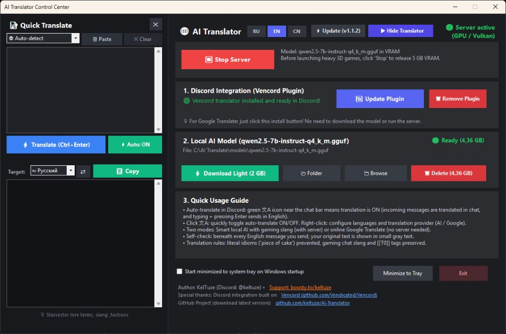

# 🌐 AI Translator Control Center

  <strong>Universal Real-Time AI & Google Translator for Discord (RU / EN / CN)</strong>

  
  &nbsp;&nbsp;
  

  
  
  
  

---

  

---

## ⚡ Highlights

- 📝 **Quick Translate Flyout Panel**: Convenient slide-out sidebar for on-the-fly text translation, auto-language detection, one-click copy, and automatic debounced auto-translate.
- 🎮 **Two-Way Live Translation**: Incoming chat messages are translated in-place; messages you send are automatically translated to the target channel language upon pressing Enter.
- 🧠 **Smart Local AI (Qwen 2.5 7B Instruct)**: High-speed GPU-accelerated local neural translation with gaming slang, gamer vocabulary, idiom adaptation, and tag protection.
- ⚡ **Google Translate Mode**: Lightweight zero-VRAM mode requiring no local server or model download.
- 🚀 **1-Click Discord Integration**: Instantly patches and preconfigures Discord via Vencord. Includes safe 1-click plugin removal to return Discord to vanilla state at any time.
- 🔄 **In-App Auto-Update**: Check and upgrade the program with one click directly from GitHub Releases without manual file copying.
- 🌐 **Multilingual Interface**: Seamless switching between Russian, English, and Chinese.

## 🚀 Quick Start

1. Download **[AI_Translator.exe](https://github.com/keltuze/AI-Translator/releases/latest/download/AI_Translator.exe)**.
2. Run the application.
3. Click **Install in Discord (1 Click)**.
4. *(Optional)* Click **Download Model** to enable local neural translation with GPU acceleration.
5. Launch Discord and enjoy seamless gaming chat translation!

---

  Author: <strong>KelTuze</strong> (Discord: <code>@keltuze</code>)

